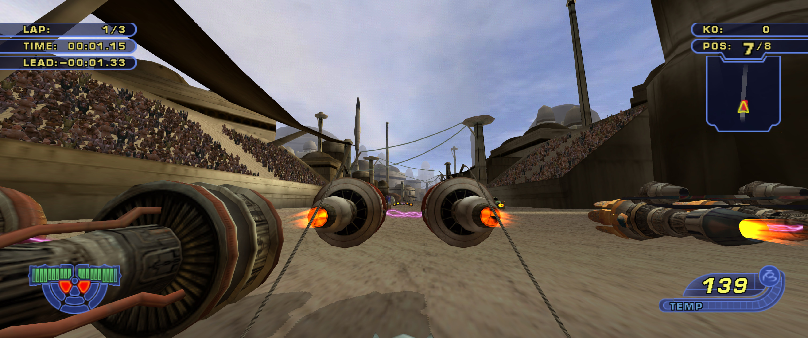
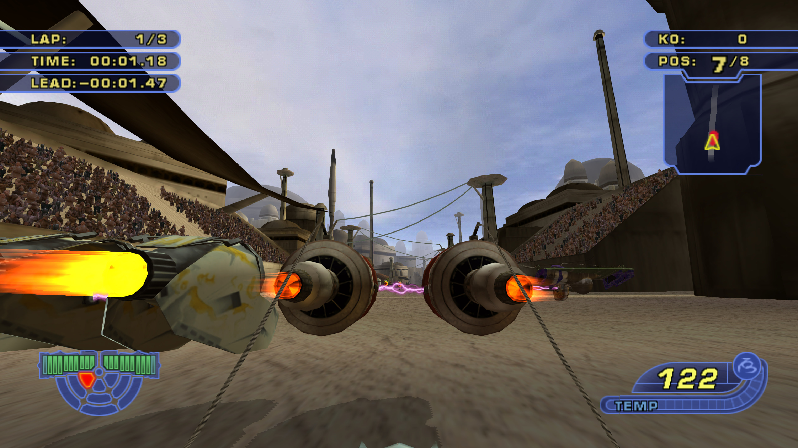
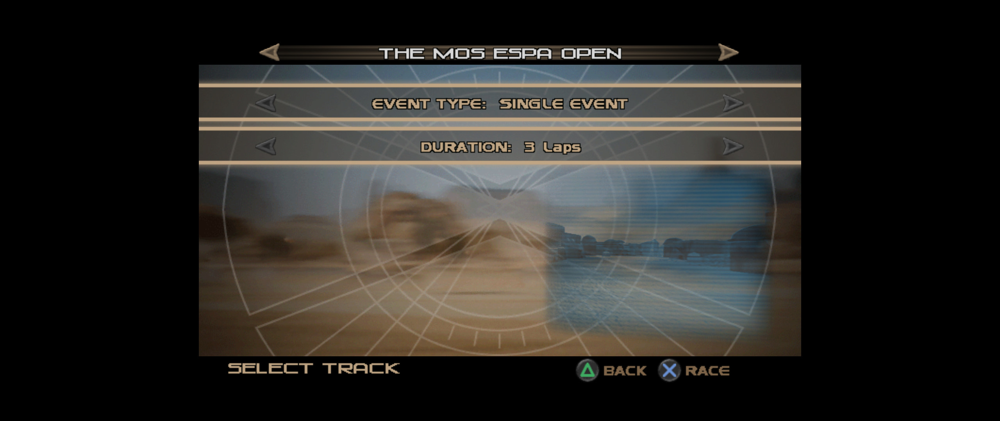
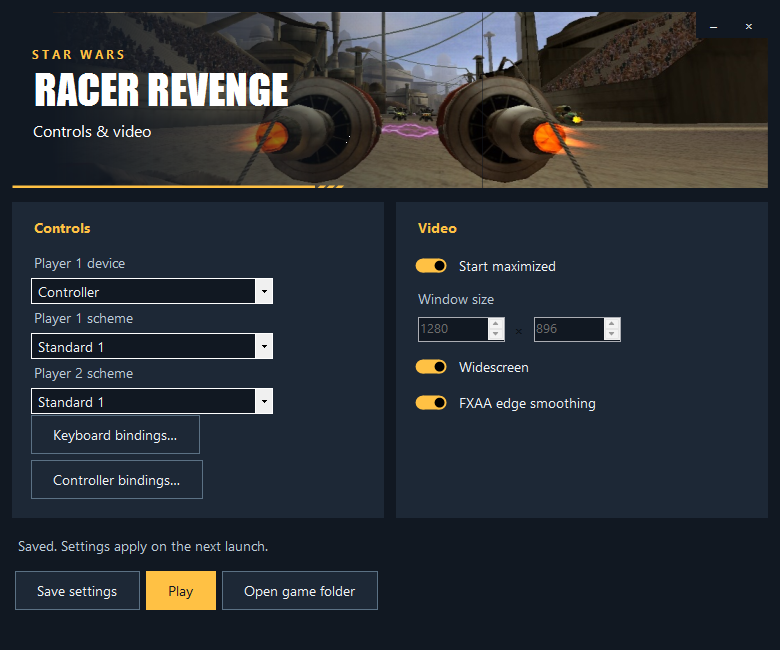
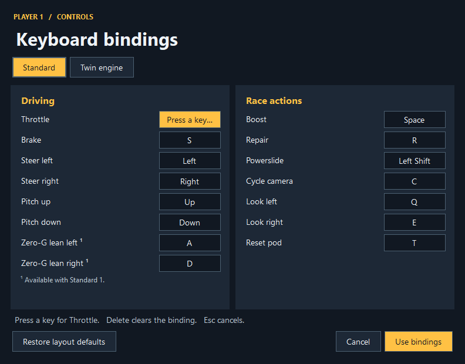
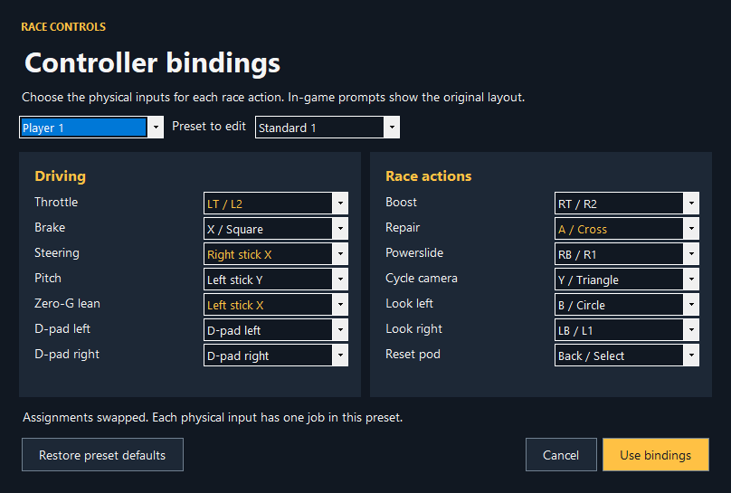

# Racer Revenge PC

A native Windows PC port of *Star Wars: Racer Revenge*, reconstructed from the PlayStation 2 game. The project uses the original game data for its courses, pods, menus, and audio. You need your own USA PS2 copy (SLUS-202.68).

## Install 0.9.0 on Windows x64

1. Download **RacerRevengePC-0.9.0-Windows-x64.zip** from the [0.9.0 release](https://github.com/GTTeancum/RacerRevengePC/releases/tag/v0.9.0). Extract the ZIP and open **RacerRevengeLauncher.exe**.
2. Select your USA *Racer Revenge* PS2 DVD as an uncompressed ISO, or browse to the extracted root folder containing `SLUS_202.68`.
3. Choose **stock** by leaving **Include Arcade + Nintendo 64 content** unchecked. For the **full installation**, check it and supply both your Racer Arcade chip-set ZIP (`swracer.zip`) and your USA Episode I Racer ROM (`.z64`, `.v64`, or `.n64`). The full installation adds two Arcade courses, six Arcade pilots, and eight N64 courses. Setup verifies both dumps and converts them locally with the bundled offline tools.
4. Choose a **new** installation folder outside the extracted disc folder and click **Install**. ROM conversion can take several minutes. After setup, choose your video and control settings and click **Play**.

**Pugwis** is included as an editable template. To race him, close the game, copy the entire `Templates/demolition-pugwis` folder to `DLC/demolition-pugwis` inside your installation, then start the game and select Pugwis on the rider screen.

You can launch **RacerRevengePC.exe** directly after setup. Open the installed launcher to change settings. Saved changes take effect the next time the game starts. To change which ROMs you import, run a freshly extracted launcher and choose a new destination.

## The Mos Espa Open

At **3440×1440**, the race camera shows more track to either side while keeping the same vertical field of view. The lap display, minimap, and engine gauges follow the edges of the window.

| 16:9 gameplay at 3840×2160 | Course selection at 2560×1080 |
| --- | --- |
|  |  |

## Windows development build

The Mos Espa screenshots above were captured on November 24, 2026, from development build **cr-179**. The launcher started the game, which went through the original rider and course menus into a race. The game captured native frames at **3840×2160**, **2560×1080**, and **3440×1440**. The original menus retain their proportions on ultrawide displays.

## Launcher controls and video

In development build **cr-181**, choose a player and a preset under **Controller bindings** to change which physical button, trigger, or stick axis performs a race action. For example, Player 1 can use the left trigger for throttle while Player 2 uses the right bumper. The original in-game prompts still show the PS2 layout. **Keyboard bindings** has separate layouts for Standard driving and Twin engine driving.

| Keyboard bindings | Controller bindings |
| --- | --- |
|  |  |

## Building from source

The Windows port and offline converter sources are included here. Supply original game data locally when building.

- [Windows x64 build guide](platform/windows/native/README-interactive50du.md)
- [Native build guide and dependencies](docs/interactive-build50dv.md)
- [Required local inputs and generated fixtures](docs/source-only-exclusions.md)
- [Development handoff](docs/HANDOFF-20261123-codex.md)
